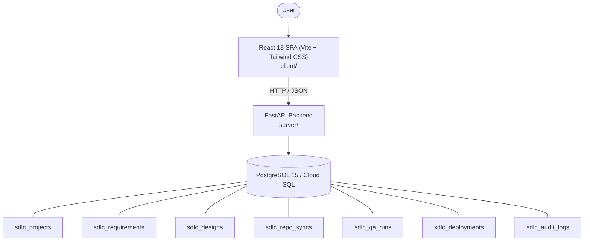

# Architecture

_Auto-generated by the SDLC Assistant from the generated codebase and the approved Feature Spec (latest: SCRUM-462). Regenerated on each push._

## System Diagram

## Tech Stack
- **language**: Java 17+
- **backend_framework**: Spring Boot 3.x
- **orm**: Spring Data JPA / Hibernate
- **database**: PostgreSQL 15 / Cloud SQL
- **frontend**: React 18 SPA (Vite + Tailwind CSS)
- **cloud_provider**: Google Cloud Platform (Cloud Run, Cloud SQL, GAR)
- **constitution_section_4_followed**: True

## Backend Modules (server/)
- server/__init__.py
- server/crud.py
- server/database.py
- server/main.py
- server/models.py
- server/routers/__init__.py
- server/routers/sdlc.py
- server/schemas.py
- server/tests/__init__.py
- server/tests/conftest.py
- server/tests/test_sdlc_api.py

## Frontend Modules (client/)
- (no client/ files found yet)

## API Endpoints
- POST /api/v1/sdlc/projects
- GET /api/v1/sdlc/projects/{project_id}
- POST /api/v1/sdlc/projects/{project_id}/requirements
- POST /api/v1/sdlc/projects/{project_id}/designs/generate
- POST /api/v1/sdlc/projects/{project_id}/designs/{design_id}/approve
- POST /api/v1/sdlc/projects/{project_id}/development/sync
- POST /api/v1/sdlc/projects/{project_id}/testing/execute
- POST /api/v1/sdlc/projects/{project_id}/deployment/deploy
- GET /api/v1/sdlc/projects/{project_id}/audit-logs

## Data Model
- sdlc_projects
- sdlc_requirements
- sdlc_designs
- sdlc_repo_syncs
- sdlc_qa_runs
- sdlc_deployments
- sdlc_audit_logs
