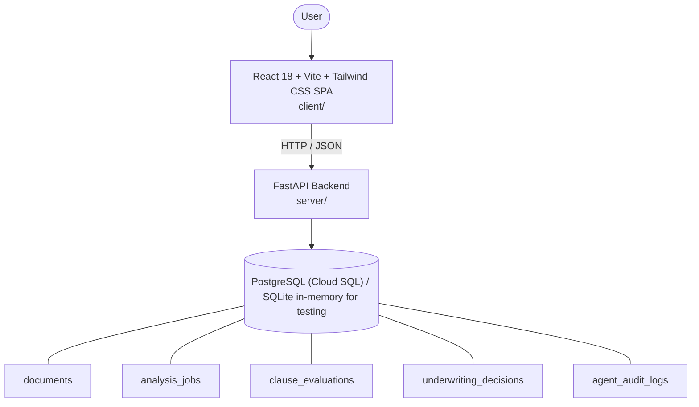

# Architecture

_Auto-generated by the SDLC Assistant from the generated codebase and the approved Feature Spec (latest: SCRUM-452). Regenerated on each push._

## System Diagram

## Tech Stack
- **language**: Python 3.11
- **backend_framework**: FastAPI
- **orm**: SQLAlchemy 2.x
- **database**: PostgreSQL (Cloud SQL) / SQLite in-memory for testing
- **frontend**: React 18 + Vite + Tailwind CSS SPA
- **cloud_provider**: GCP (Cloud Run, Cloud SQL)
- **constitution_section_4_followed**: True

## Backend Modules (server/)
- server/__init__.py
- server/config.py
- server/database.py
- server/main.py
- server/models.py
- server/routers/__init__.py
- server/routers/analysis.py
- server/routers/audit.py
- server/routers/decisions.py
- server/routers/documents.py
- server/schemas/__init__.py
- server/schemas/analysis.py
- server/schemas/audit.py
- server/schemas/decision.py
- server/schemas/document.py
- server/services/__init__.py
- server/services/decision_service.py
- server/services/document_service.py
- server/services/orchestrator_service.py
- server/services/parser_service.py
- server/tests/__init__.py
- server/tests/conftest.py
- server/tests/test_analysis.py
- server/tests/test_audit.py
- server/tests/test_decisions.py
- server/tests/test_documents.py

## Frontend Modules (client/)
- (no client/ files found yet)

## API Endpoints
- POST /api/v1/documents/upload
- GET /api/v1/documents
- GET /api/v1/documents/{doc_id}
- POST /api/v1/analysis/trigger
- GET /api/v1/analysis/{job_id}
- GET /api/v1/analysis/{job_id}/clauses
- POST /api/v1/decisions
- GET /api/v1/audit/logs/{job_id}

## Data Model
- documents
- analysis_jobs
- clause_evaluations
- underwriting_decisions
- agent_audit_logs
