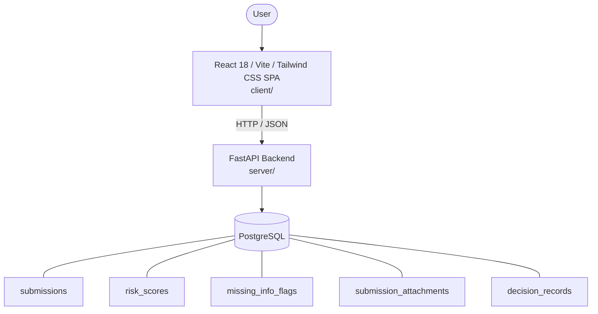

# Architecture

_Auto-generated by the SDLC Assistant from the generated codebase and the approved Feature Spec (latest: SCRUM-441). Regenerated on each push._

## System Diagram

## Tech Stack
- **language**: Python 3.11
- **backend_framework**: FastAPI
- **orm**: SQLAlchemy 2.x
- **database**: PostgreSQL
- **frontend**: React 18 / Vite / Tailwind CSS SPA
- **cloud_provider**: Google Cloud Platform (GCP)
- **constitution_section_4_followed**: True

## Backend Modules (server/)
- server/__init__.py
- server/config.py
- server/database.py
- server/main.py
- server/models/__init__.py
- server/models/attachment.py
- server/models/decision.py
- server/models/missing_info.py
- server/models/risk_score.py
- server/models/submission.py
- server/routers/__init__.py
- server/routers/decisions.py
- server/routers/submissions.py
- server/routers/underwriting.py
- server/schemas/__init__.py
- server/schemas/decision.py
- server/schemas/missing_info.py
- server/schemas/risk_score.py
- server/schemas/submission.py
- server/services/__init__.py
- server/services/decision_service.py
- server/services/scoring_service.py
- server/services/submission_service.py
- server/services/validation_service.py
- server/tests/__init__.py
- server/tests/conftest.py
- server/tests/test_decisions.py
- server/tests/test_scoring.py
- server/tests/test_submissions.py
- server/tests/test_underwriting.py

## Frontend Modules (client/)
- (no client/ files found yet)

## API Endpoints
- POST /api/v1/reinsurance/submissions
- GET /api/v1/reinsurance/submissions/{id}
- GET /api/v1/reinsurance/submissions
- GET /api/v1/reinsurance/underwriting/queue
- POST /api/v1/reinsurance/underwriting/score/{id}
- POST /api/v1/reinsurance/underwriting/decisions

## Data Model
- submissions
- risk_scores
- missing_info_flags
- submission_attachments
- decision_records
