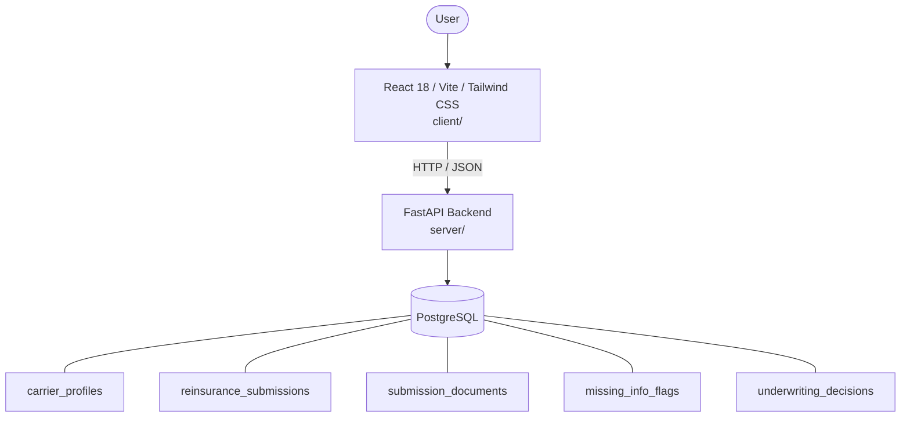

# Architecture

_Auto-generated by the SDLC Assistant from the generated codebase and the approved Feature Spec (latest: SCRUM-442). Regenerated on each push._

## System Diagram

## Tech Stack
- **language**: Python 3.11
- **backend_framework**: FastAPI
- **orm**: SQLAlchemy 2.x
- **database**: PostgreSQL
- **frontend**: React 18 / Vite / Tailwind CSS
- **cloud_provider**: Google Cloud Platform (GCP - Cloud Run, Cloud SQL, GCS)
- **constitution_section_4_followed**: True

## Backend Modules (server/)
- server/__init__.py
- server/database.py
- server/main.py
- server/models.py
- server/routers/__init__.py
- server/routers/decisions.py
- server/routers/submissions.py
- server/routers/underwriting.py
- server/schemas.py
- server/services/__init__.py
- server/services/checklist_service.py
- server/services/decision_service.py
- server/services/scoring_engine.py
- server/tests/__init__.py
- server/tests/conftest.py
- server/tests/test_decisions.py
- server/tests/test_scoring_checklist.py
- server/tests/test_submissions.py
- server/tests/test_underwriting.py

## Frontend Modules (client/)
- (no client/ files found yet)

## API Endpoints
- POST /api/v1/submissions
- GET /api/v1/submissions/{id}
- GET /api/v1/submissions
- POST /api/v1/submissions/{id}/attachments
- GET /api/v1/underwriting/queue
- GET /api/v1/underwriting/{id}/score-breakdown
- GET /api/v1/underwriting/{id}/checklist
- POST /api/v1/decisions/quote
- POST /api/v1/decisions/decline
- GET /api/v1/decisions/{submission_id}

## Data Model
- carrier_profiles
- reinsurance_submissions
- submission_documents
- missing_info_flags
- underwriting_decisions
