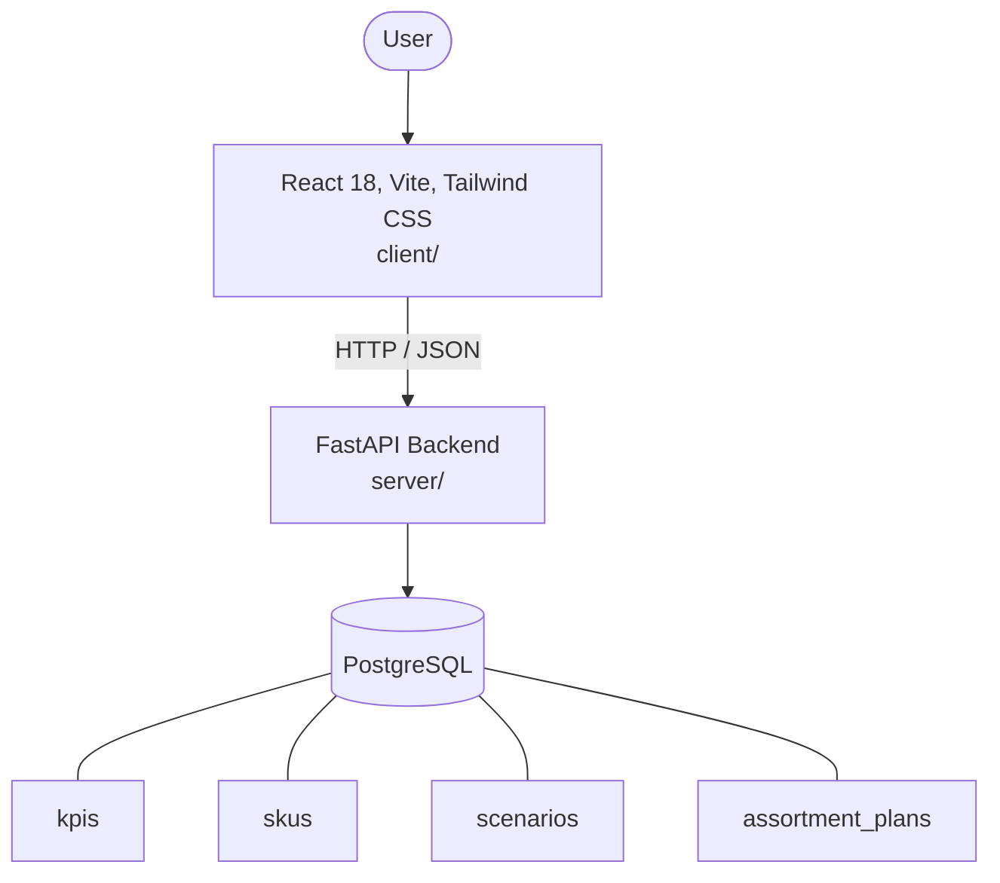

# Architecture

_Auto-generated by the SDLC Assistant from the generated codebase and the approved Feature Spec (latest: SCRUM-410). Regenerated on each push._

## System Diagram

## Tech Stack
- **language**: Python
- **backend_framework**: FastAPI
- **orm**: SQLAlchemy 2.x
- **database**: PostgreSQL
- **frontend**: React 18, Vite, Tailwind CSS
- **cloud_provider**: GCP
- **constitution_section_4_followed**: True

## Backend Modules (server/)
- server/__init__.py
- server/crud.py
- server/database.py
- server/main.py
- server/models.py
- server/routers/__init__.py
- server/routers/assortment_plans.py
- server/routers/kpis.py
- server/routers/scenarios.py
- server/routers/skus.py
- server/schemas.py
- server/tests/__init__.py
- server/tests/conftest.py
- server/tests/test_assortment_plans.py
- server/tests/test_kpis.py
- server/tests/test_scenarios.py
- server/tests/test_skus.py

## Frontend Modules (client/)
- (no client/ files found yet)

## API Endpoints
- GET /api/v1/kpis
- GET /api/v1/skus
- POST /api/v1/scenarios/calculate
- POST /api/v1/assortment-plans/submit

## Data Model
- kpis
- skus
- scenarios
- assortment_plans
