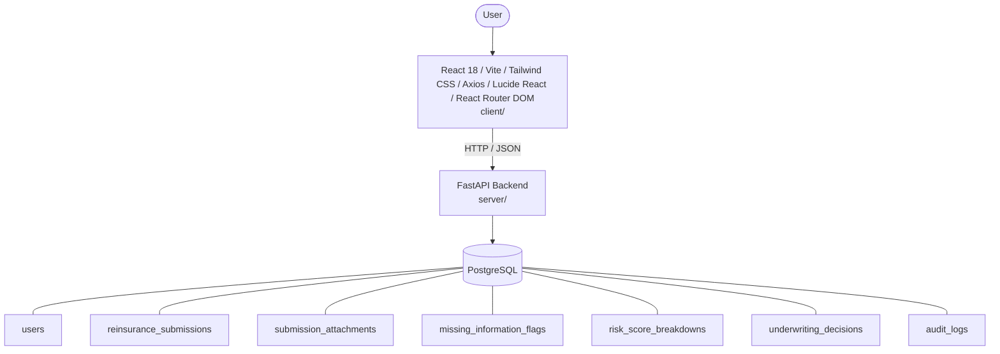

# Architecture

_Auto-generated by the SDLC Assistant from the generated codebase and the approved Feature Spec (latest: SCRUM-439). Regenerated on each push._

## System Diagram

## Tech Stack
- **language**: Python 3.11 / JavaScript (React 18)
- **backend_framework**: FastAPI
- **orm**: SQLAlchemy 2.x
- **database**: PostgreSQL
- **frontend**: React 18 / Vite / Tailwind CSS / Axios / Lucide React / React Router DOM
- **cloud_provider**: GCP (Cloud Run, Cloud SQL, GCS)
- **constitution_section_4_followed**: True

## Backend Modules (server/)
- server/__init__.py
- server/config.py
- server/database.py
- server/main.py
- server/models/__init__.py
- server/models/attachment.py
- server/models/audit_log.py
- server/models/decision.py
- server/models/missing_flag.py
- server/models/risk_score.py
- server/models/submission.py
- server/models/user.py
- server/routers/__init__.py
- server/routers/auth_router.py
- server/routers/submission_router.py
- server/routers/underwriting_router.py
- server/schemas/__init__.py
- server/schemas/decision.py
- server/schemas/submission.py
- server/schemas/underwriting.py
- server/services/__init__.py
- server/services/audit_service.py
- server/services/missing_detector.py
- server/services/scoring_engine.py
- server/services/submission_service.py
- server/services/underwriting_service.py
- server/tests/__init__.py
- server/tests/conftest.py
- server/tests/test_submissions.py
- server/tests/test_underwriting.py

## Frontend Modules (client/)
- (no client/ files found yet)

## API Endpoints
- POST /api/v1/submissions
- POST /api/v1/submissions/{submission_id}/attachments
- GET /api/v1/submissions
- GET /api/v1/underwriting/queue
- GET /api/v1/underwriting/submissions/{submission_id}
- POST /api/v1/underwriting/submissions/{submission_id}/lock
- POST /api/v1/underwriting/submissions/{submission_id}/decisions

## Data Model
- users
- reinsurance_submissions
- submission_attachments
- missing_information_flags
- risk_score_breakdowns
- underwriting_decisions
- audit_logs
