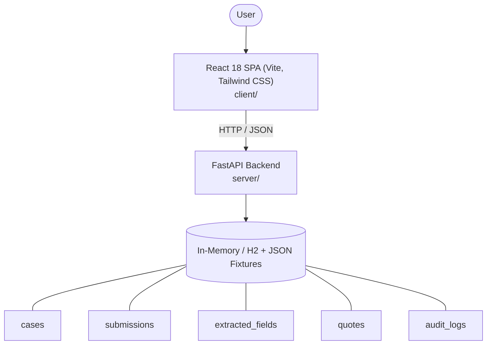

# Architecture

_Auto-generated by the SDLC Assistant from the generated codebase and the approved Feature Spec (latest: SCRUM-464). Regenerated on each push._

## System Diagram

## Tech Stack
- **language**: Java + TypeScript/JavaScript
- **backend_framework**: Spring Boot 3.x (Java 21)
- **orm**: Spring Data JPA / H2
- **database**: In-Memory / H2 + JSON Fixtures
- **frontend**: React 18 SPA (Vite, Tailwind CSS)
- **cloud_provider**: GCP (Cloud Run)
- **constitution_section_4_followed**: True

## Backend Modules (server/)
- server/__init__.py
- server/database.py
- server/main.py
- server/models.py
- server/routers/__init__.py
- server/routers/cases.py
- server/routers/health.py
- server/routers/scenarios.py
- server/schemas.py
- server/services/__init__.py
- server/services/agents.py
- server/services/fixtures.py
- server/services/orchestrator.py
- server/services/rules_engine.py
- server/tests/__init__.py
- server/tests/conftest.py
- server/tests/test_business_rules.py
- server/tests/test_cases.py
- server/tests/test_pricing_and_bind.py
- server/tests/test_scenarios.py
- server/tests/test_stages.py

## Frontend Modules (client/)
- (no client/ files found yet)

## API Endpoints
- GET /api/v1/qtb/scenarios
- POST /api/v1/qtb/scenarios/{scenarioId}/load
- GET /api/v1/qtb/cases/{caseId}
- GET /api/v1/qtb/cases/{caseId}/stages
- POST /api/v1/qtb/cases/{caseId}/stages/{stageKey}/execute
- POST /api/v1/qtb/cases/{caseId}/overrides
- POST /api/v1/qtb/cases/{caseId}/pricing/calculate
- POST /api/v1/qtb/cases/{caseId}/quotes
- POST /api/v1/qtb/cases/{caseId}/approvals/{approvalId}
- GET /api/v1/qtb/cases/{caseId}/bind-readiness
- POST /api/v1/qtb/cases/{caseId}/bind
- GET /api/v1/qtb/cases/{caseId}/audit-logs

## Data Model
- cases
- submissions
- extracted_fields
- quotes
- audit_logs
