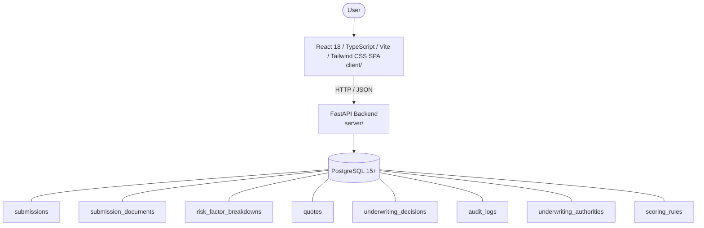

# Architecture

_Auto-generated by the SDLC Assistant from the generated codebase and the approved Feature Spec (latest: SCRUM-463). Regenerated on each push._

## System Diagram

## Tech Stack
- **language**: Java 21
- **backend_framework**: Spring Boot 3.x
- **orm**: Spring Data JPA / Hibernate
- **database**: PostgreSQL 15+
- **frontend**: React 18 / TypeScript / Vite / Tailwind CSS SPA
- **cloud_provider**: GCP (Cloud Run, Cloud SQL, GCS)
- **constitution_section_4_followed**: True

## Backend Modules (server/)
- server/__init__.py
- server/database.py
- server/main.py
- server/models.py
- server/routers/__init__.py
- server/routers/config.py
- server/routers/dashboard.py
- server/routers/quotes.py
- server/routers/submissions.py
- server/schemas.py
- server/services/__init__.py
- server/services/audit_service.py
- server/services/dashboard_service.py
- server/services/intake_service.py
- server/services/quote_service.py
- server/services/scoring_engine.py
- server/services/validation_service.py
- server/services/workflow_service.py
- server/src/__init__.py
- server/src/main/__init__.py
- server/src/main/java/__init__.py
- server/src/main/java/com/__init__.py
- server/src/main/java/com/reinsurance/__init__.py
- server/src/main/java/com/reinsurance/portal/__init__.py
- server/src/main/java/com/reinsurance/portal/config/__init__.py
- server/src/main/java/com/reinsurance/portal/controller/__init__.py
- server/src/main/java/com/reinsurance/portal/dto/__init__.py
- server/src/main/java/com/reinsurance/portal/entity/__init__.py
- server/src/main/java/com/reinsurance/portal/exception/__init__.py
- server/src/main/java/com/reinsurance/portal/repository/__init__.py
- server/src/main/java/com/reinsurance/portal/service/__init__.py
- server/src/main/resources/__init__.py
- server/src/test/__init__.py
- server/src/test/java/__init__.py
- server/src/test/java/com/__init__.py
- server/src/test/java/com/reinsurance/__init__.py
- server/src/test/java/com/reinsurance/portal/__init__.py
- server/src/test/java/com/reinsurance/portal/controller/__init__.py
- server/src/test/java/com/reinsurance/portal/service/__init__.py
- server/tests/__init__.py

## Frontend Modules (client/)
- (no client/ files found yet)

## API Endpoints
- POST /api/v1/submissions
- POST /api/v1/submissions/{id}/documents
- GET /api/v1/submissions
- GET /api/v1/submissions/{id}
- POST /api/v1/submissions/{id}/score
- PATCH /api/v1/submissions/{id}/status
- POST /api/v1/submissions/{id}/referral/decision
- POST /api/v1/submissions/{id}/quotes
- GET /api/v1/submissions/{id}/audit-trail
- GET /api/v1/dashboard/metrics
- GET /api/v1/config/scoring-rules

## Data Model
- submissions
- submission_documents
- risk_factor_breakdowns
- quotes
- underwriting_decisions
- audit_logs
- underwriting_authorities
- scoring_rules
