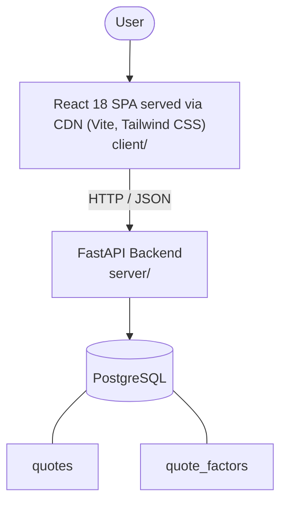

# Architecture

_Auto-generated by the SDLC Assistant from the generated codebase and the approved Feature Spec (latest: SCRUM-431). Regenerated on each push._

## System Diagram

## Tech Stack
- **language**: Python 3.11 / JavaScript (React 18)
- **backend_framework**: FastAPI
- **orm**: SQLAlchemy 2.x
- **database**: PostgreSQL
- **frontend**: React 18 SPA served via CDN (Vite, Tailwind CSS)
- **cloud_provider**: GCP (Cloud Run, Cloud SQL, Artifact Registry)
- **constitution_section_4_followed**: True

## Backend Modules (server/)
- server/__init__.py
- server/database.py
- server/main.py
- server/models.py
- server/rating_engine.py
- server/routers/__init__.py
- server/routers/health.py
- server/routers/quotes.py
- server/schemas.py
- server/tests/__init__.py
- server/tests/conftest.py
- server/tests/test_calculator.py
- server/tests/test_rating_engine.py

## Frontend Modules (client/)
- (no client/ files found yet)

## API Endpoints
- POST /api/v1/quotes/calculate
- GET /api/v1/quotes/{id}
- GET /api/v1/health

## Data Model
- quotes
- quote_factors
