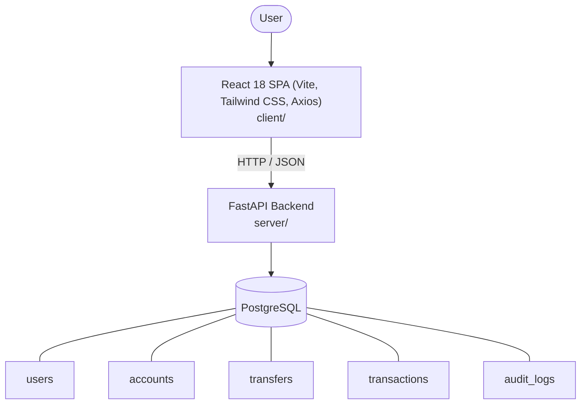

# Architecture

_Auto-generated by the SDLC Assistant from the generated codebase and the approved Feature Spec (latest: SCRUM-436). Regenerated on each push._

## System Diagram

## Tech Stack
- **language**: Java
- **backend_framework**: Spring Boot 3
- **orm**: Spring Data JPA / Hibernate 6
- **database**: PostgreSQL
- **frontend**: React 18 SPA (Vite, Tailwind CSS, Axios)
- **cloud_provider**: GCP (Cloud Run, Cloud SQL, Cloud Memorystore)
- **constitution_section_4_followed**: True

## Backend Modules (server/)
- server/__init__.py
- server/database.py
- server/main.py
- server/models.py
- server/routers/__init__.py
- server/routers/accounts.py
- server/routers/auth.py
- server/routers/transfers.py
- server/schemas.py
- server/security.py
- server/services/__init__.py
- server/services/account_service.py
- server/services/auth_service.py
- server/services/transfer_service.py
- server/tests/__init__.py
- server/tests/conftest.py
- server/tests/test_accounts.py
- server/tests/test_auth.py
- server/tests/test_transfers.py

## Frontend Modules (client/)
- (no client/ files found yet)

## API Endpoints
- POST /api/v1/auth/register
- POST /api/v1/auth/login
- POST /api/v1/auth/logout
- POST /api/v1/auth/refresh
- GET /api/v1/accounts
- GET /api/v1/accounts/{id}
- GET /api/v1/accounts/{id}/transactions
- POST /api/v1/transfers
- GET /api/v1/transfers/{id}

## Data Model
- users
- accounts
- transfers
- transactions
- audit_logs
