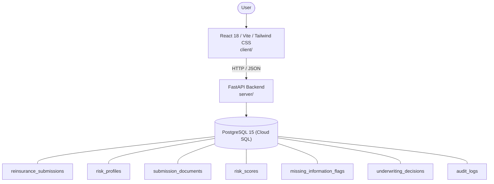

# Architecture

_Auto-generated by the SDLC Assistant from the generated codebase and the approved Feature Spec (latest: SCRUM-438). Regenerated on each push._

## System Diagram

## Tech Stack
- **language**: Python 3.11
- **backend_framework**: FastAPI
- **orm**: SQLAlchemy 2.x
- **database**: PostgreSQL 15 (Cloud SQL)
- **frontend**: React 18 / Vite / Tailwind CSS
- **cloud_provider**: Google Cloud Platform (Cloud Run)
- **constitution_section_4_followed**: True

## Backend Modules (server/)
- server/__init__.py
- server/database.py
- server/main.py
- server/models.py
- server/routers/__init__.py
- server/routers/auth.py
- server/routers/decisions.py
- server/routers/submissions.py
- server/routers/underwriting.py
- server/schemas.py
- server/services/__init__.py
- server/services/flagging_engine.py
- server/services/scoring_engine.py
- server/tests/__init__.py
- server/tests/conftest.py
- server/tests/test_decisions.py
- server/tests/test_scoring.py
- server/tests/test_submissions.py
- server/tests/test_underwriting.py

## Frontend Modules (client/)
- (no client/ files found yet)

## API Endpoints
- POST /api/v1/submissions
- GET /api/v1/submissions
- GET /api/v1/submissions/{id}
- GET /api/v1/underwriting/queue
- POST /api/v1/underwriting/submissions/{id}/score
- POST /api/v1/underwriting/submissions/{id}/decisions
- GET /api/v1/underwriting/submissions/{id}/audit

## Data Model
- reinsurance_submissions
- risk_profiles
- submission_documents
- risk_scores
- missing_information_flags
- underwriting_decisions
- audit_logs
