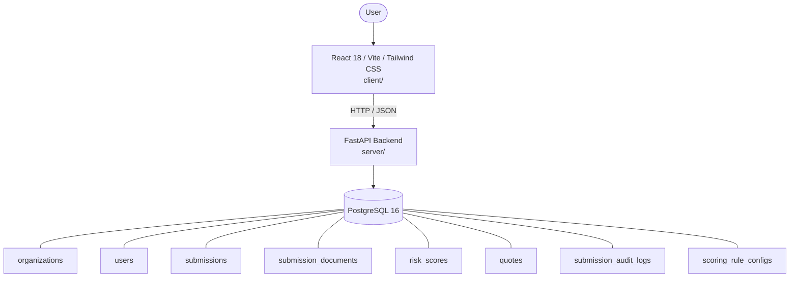

# Architecture

_Auto-generated by the SDLC Assistant from the generated codebase and the approved Feature Spec (latest: SCRUM-453). Regenerated on each push._

## System Diagram

## Tech Stack
- **language**: Java 21
- **backend_framework**: Spring Boot 3.x
- **orm**: Spring Data JPA / Hibernate
- **database**: PostgreSQL 16
- **frontend**: React 18 / Vite / Tailwind CSS
- **cloud_provider**: Google Cloud Platform (Cloud Run, Cloud SQL, Cloud Storage)
- **constitution_section_4_followed**: True

## Backend Modules (server/)
- server/__init__.py
- server/config.py
- server/database.py
- server/dependencies/__init__.py
- server/dependencies/auth.py
- server/main.py
- server/models/__init__.py
- server/models/audit_log.py
- server/models/document.py
- server/models/organization.py
- server/models/quote.py
- server/models/risk_score.py
- server/models/scoring_config.py
- server/models/submission.py
- server/models/user.py
- server/routers/__init__.py
- server/routers/analytics.py
- server/routers/audit.py
- server/routers/auth.py
- server/routers/config.py
- server/routers/decisions.py
- server/routers/quotes.py
- server/routers/scoring.py
- server/routers/submissions.py
- server/schemas/__init__.py
- server/schemas/analytics.py
- server/schemas/auth.py
- server/schemas/config.py
- server/schemas/decision.py
- server/schemas/document.py
- server/schemas/quote.py
- server/schemas/risk_score.py
- server/schemas/submission.py
- server/services/__init__.py
- server/services/audit_service.py
- server/services/auth_service.py
- server/services/quote_service.py
- server/services/scoring_service.py
- server/services/submission_service.py
- server/services/workflow_service.py

## Frontend Modules (client/)
- (no client/ files found yet)

## API Endpoints
- POST /api/v1/submissions
- GET /api/v1/submissions
- GET /api/v1/submissions/{id}
- POST /api/v1/submissions/{id}/score
- PATCH /api/v1/submissions/{id}/status
- POST /api/v1/submissions/{id}/referral/decision
- POST /api/v1/submissions/{id}/quotes
- POST /api/v1/submissions/{id}/decisions
- GET /api/v1/submissions/{id}/audit-trail
- GET /api/v1/analytics/manager-dashboard
- GET /api/v1/config/scoring-rules
- PUT /api/v1/config/scoring-rules

## Data Model
- organizations
- users
- submissions
- submission_documents
- risk_scores
- quotes
- submission_audit_logs
- scoring_rule_configs
