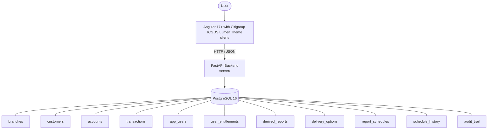

# Architecture

_Auto-generated by the SDLC Assistant from the generated codebase and the approved Feature Spec (latest: SCRUM-476). Regenerated on each push._

## System Diagram

## Tech Stack
- **language**: Java 21
- **backend_framework**: Spring Boot 3.3.x
- **orm**: Hibernate / Spring Data JPA
- **database**: PostgreSQL 16
- **frontend**: Angular 17+ with Citigroup ICGDS Lumen Theme
- **cloud_provider**: GCP (Google Cloud Run + Cloud SQL)
- **constitution_section_4_followed**: False

## Backend Modules (server/)
- (no server/ files found yet)

## Frontend Modules (client/)
- (no client/ files found yet)

## API Endpoints
- POST /api/v1/auth/login
- GET /api/v1/entitlements/user
- GET /api/v1/reports/base
- GET /api/v1/reports/criteria/defaults
- POST /api/v1/reports/criteria
- POST /api/v1/reports/execution/run
- GET /api/v1/reports/my-reports
- GET /api/v1/delivery-options
- POST /api/v1/delivery-options
- POST /api/v1/delivery-options/{id}/authorize
- POST /api/v1/schedules
- POST /api/v1/schedules/{id}/authorize

## Data Model
- branches
- customers
- accounts
- transactions
- app_users
- user_entitlements
- derived_reports
- delivery_options
- report_schedules
- schedule_history
- audit_trail
