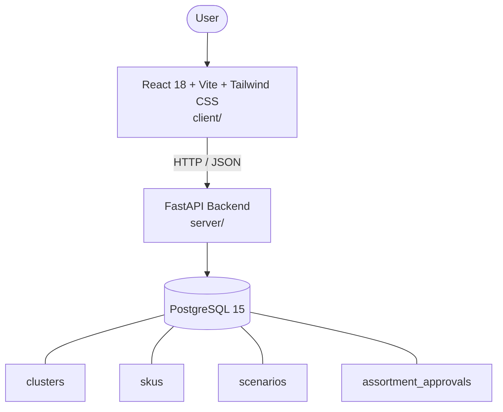

# Architecture

_Auto-generated by the SDLC Assistant from the generated codebase and the approved Feature Spec (latest: SCRUM-416). Regenerated on each push._

## System Diagram

## Tech Stack
- **language**: Python 3.11
- **backend_framework**: FastAPI
- **orm**: SQLAlchemy 2.x
- **database**: PostgreSQL 15
- **frontend**: React 18 + Vite + Tailwind CSS
- **cloud_provider**: GCP (Cloud Run + Cloud SQL)
- **constitution_section_4_followed**: True

## Backend Modules (server/)
- server/__init__.py
- server/app/__init__.py
- server/app/api/__init__.py
- server/app/api/v1/__init__.py
- server/app/api/v1/endpoints/__init__.py
- server/app/api/v1/endpoints/approvals.py
- server/app/api/v1/endpoints/kpis.py
- server/app/api/v1/endpoints/scenarios.py
- server/app/api/v1/endpoints/skus.py
- server/app/api/v1/router.py
- server/app/core/__init__.py
- server/app/core/config.py
- server/app/core/database.py
- server/app/main.py
- server/app/models/__init__.py
- server/app/models/approval.py
- server/app/models/cluster.py
- server/app/models/scenario.py
- server/app/models/sku.py
- server/app/schemas/__init__.py
- server/app/schemas/approval.py
- server/app/schemas/kpi.py
- server/app/schemas/scenario.py
- server/app/schemas/sku.py
- server/app/services/__init__.py
- server/app/services/assortment_service.py
- server/app/services/audit_service.py
- server/app/services/guardrail_service.py
- server/app/services/scenario_engine.py
- server/tests/__init__.py
- server/tests/conftest.py
- server/tests/test_assortment_api.py

## Frontend Modules (client/)
- (no client/ files found yet)

## API Endpoints
- GET /api/v1/assortment/kpis
- GET /api/v1/assortment/skus
- POST /api/v1/assortment/scenario-impact
- POST /api/v1/assortment/approvals

## Data Model
- clusters
- skus
- scenarios
- assortment_approvals
