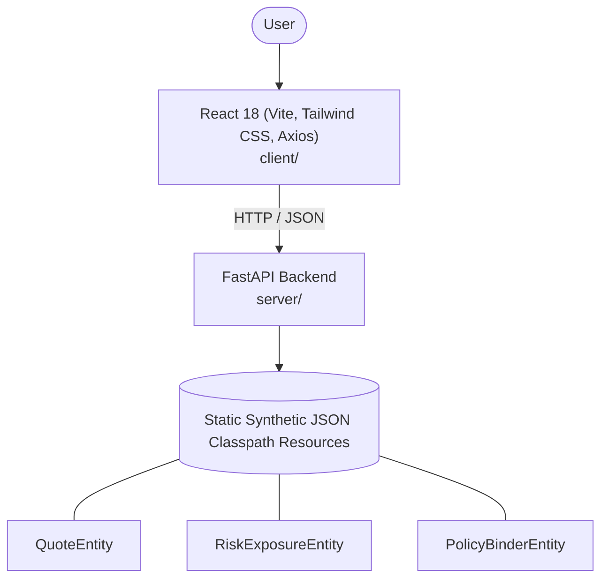

# Architecture

_Auto-generated by the SDLC Assistant from the generated codebase and the approved Feature Spec (latest: SCRUM-454). Regenerated on each push._

## System Diagram

## Tech Stack
- **language**: Java 17
- **backend_framework**: Spring Boot 3
- **orm**: In-Memory ConcurrentHashMap (Mock Repository)
- **database**: Static Synthetic JSON Classpath Resources
- **frontend**: React 18 (Vite, Tailwind CSS, Axios)
- **cloud_provider**: Google Cloud Platform (GCP Cloud Run)
- **constitution_section_4_followed**: True

## Backend Modules (server/)
- server/__init__.py
- server/data/__init__.py
- server/database.py
- server/main.py
- server/models.py
- server/routers/__init__.py
- server/routers/binders.py
- server/routers/health.py
- server/routers/quotes.py
- server/routers/risks.py
- server/schemas.py
- server/services/__init__.py
- server/services/data_loader.py
- server/services/pricing.py
- server/src/__init__.py
- server/src/main/__init__.py
- server/src/main/java/__init__.py
- server/src/main/java/com/__init__.py
- server/src/main/java/com/genre/__init__.py
- server/src/main/java/com/genre/qtb/__init__.py
- server/src/main/java/com/genre/qtb/config/__init__.py
- server/src/main/java/com/genre/qtb/controller/__init__.py
- server/src/main/java/com/genre/qtb/dto/__init__.py
- server/src/main/java/com/genre/qtb/model/__init__.py
- server/src/main/java/com/genre/qtb/repository/__init__.py
- server/src/main/java/com/genre/qtb/service/__init__.py
- server/src/main/resources/__init__.py
- server/src/main/resources/data/__init__.py
- server/tests/__init__.py
- server/tests/conftest.py
- server/tests/test_binders.py
- server/tests/test_health.py
- server/tests/test_quotes.py
- server/tests/test_risks.py

## Frontend Modules (client/)
- (no client/ files found yet)

## API Endpoints
- GET /api/v1/quotes
- POST /api/v1/quotes
- GET /api/v1/quotes/{id}
- GET /api/v1/risks
- PATCH /api/v1/risks/{id}/decision
- POST /api/v1/binders
- GET /api/v1/binders/{id}
- GET /api/v1/health

## Data Model
- QuoteEntity
- RiskExposureEntity
- PolicyBinderEntity
