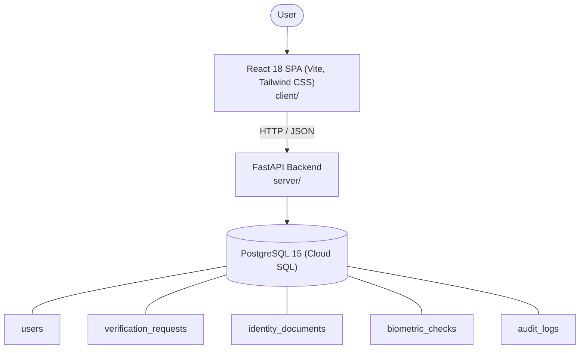

# Architecture

_Auto-generated by the SDLC Assistant from the generated codebase and the approved Feature Spec (latest: SCRUM-1). Regenerated on each push._

## System Diagram

## Tech Stack
- **language**: Java 21
- **backend_framework**: Spring Boot 3.2
- **orm**: Spring Data JPA / Hibernate
- **database**: PostgreSQL 15 (Cloud SQL)
- **frontend**: React 18 SPA (Vite, Tailwind CSS)
- **cloud_provider**: GCP (Google Cloud Platform)
- **constitution_section_4_followed**: False

## Backend Modules (server/)
- (no server/ files found yet)

## Frontend Modules (client/)
- (no client/ files found yet)

## API Endpoints
- POST /api/v1/auth/register
- POST /api/v1/auth/login
- POST /api/v1/verifications
- GET /api/v1/verifications/{id}/status
- POST /api/v1/documents/upload
- POST /api/v1/biometrics/liveness-check
- GET /api/v1/compliance/queue
- POST /api/v1/compliance/adjudicate
- GET /api/v1/audit/logs

## Data Model
- users
- verification_requests
- identity_documents
- biometric_checks
- audit_logs
