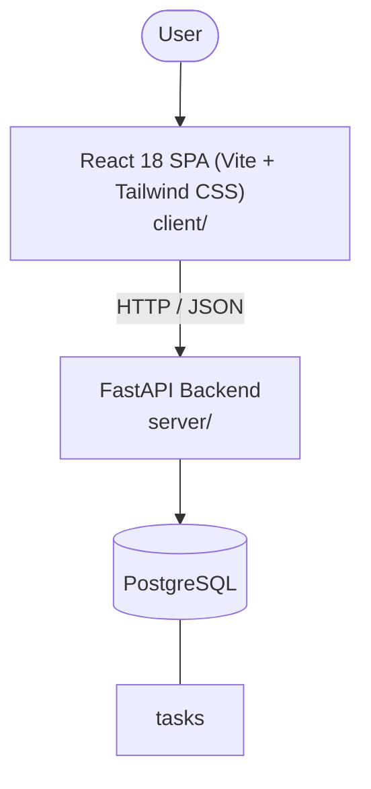

# Architecture

_Auto-generated by the SDLC Assistant from the generated codebase and the approved Feature Spec (latest: SCRUM-488). Regenerated on each push._

## System Diagram

## Tech Stack
- **language**: Java
- **backend_framework**: Spring Boot
- **orm**: Spring Data JPA / Hibernate
- **database**: PostgreSQL
- **frontend**: React 18 SPA (Vite + Tailwind CSS)
- **cloud_provider**: Google Cloud Platform (GCP)
- **constitution_section_4_followed**: True

## Backend Modules (server/)
- server/__init__.py
- server/crud.py
- server/database.py
- server/main.py
- server/models.py
- server/routers/__init__.py
- server/routers/health.py
- server/routers/tasks.py
- server/schemas.py
- server/tests/__init__.py
- server/tests/conftest.py
- server/tests/test_health.py
- server/tests/test_tasks.py

## Frontend Modules (client/)
- (no client/ files found yet)

## API Endpoints
- GET /api/v1/tasks
- POST /api/v1/tasks
- PATCH /api/v1/tasks/{id}
- DELETE /api/v1/tasks/{id}

## Data Model
- tasks
