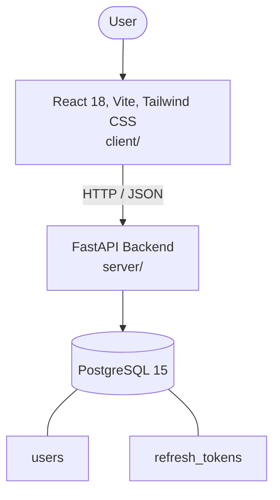

# Architecture

_Auto-generated by the SDLC Assistant from the generated codebase and the approved Feature Spec (latest: SCRUM-491). Regenerated on each push._

## System Diagram

## Tech Stack
- **language**: Java 17+
- **backend_framework**: Spring Boot 3.x
- **orm**: Spring Data JPA / Hibernate
- **database**: PostgreSQL 15
- **frontend**: React 18, Vite, Tailwind CSS
- **cloud_provider**: Google Cloud Platform (GCP)
- **constitution_section_4_followed**: True

## Backend Modules (server/)
- (no server/ files found yet)

## Frontend Modules (client/)
- (no client/ files found yet)

## API Endpoints
- POST /api/v1/auth/register
- POST /api/v1/auth/login
- POST /api/v1/auth/refresh
- POST /api/v1/auth/logout
- GET /api/v1/auth/me

## Data Model
- users
- refresh_tokens
