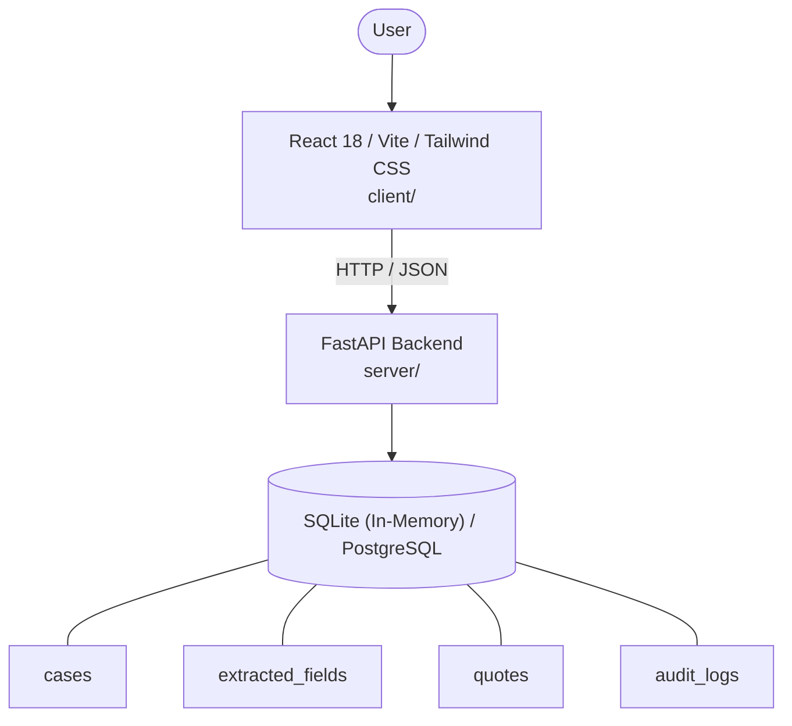

# Architecture

_Auto-generated by the SDLC Assistant from the generated codebase and the approved Feature Spec (latest: SCRUM-464). Regenerated on each push._

## System Diagram

## Tech Stack
- **language**: Python 3.11
- **backend_framework**: FastAPI
- **orm**: SQLAlchemy 2.x
- **database**: SQLite (In-Memory) / PostgreSQL
- **frontend**: React 18 / Vite / Tailwind CSS
- **cloud_provider**: GCP (Cloud Run)
- **constitution_section_4_followed**: True

## Backend Modules (server/)
- server/__init__.py
- server/database.py
- server/main.py
- server/models.py
- server/routers/__init__.py
- server/routers/cases.py
- server/routers/health.py
- server/routers/scenarios.py
- server/schemas.py
- server/services/__init__.py
- server/services/agents.py
- server/services/fixtures.py
- server/services/orchestrator.py
- server/services/rules_engine.py
- server/tests/__init__.py
- server/tests/conftest.py
- server/tests/test_business_rules.py
- server/tests/test_cases.py
- server/tests/test_pricing_and_bind.py
- server/tests/test_scenarios.py
- server/tests/test_stages.py

## Frontend Modules (client/)
- client/eslint.config.js
- client/postcss.config.js
- client/src/App.jsx
- client/src/App.test.jsx
- client/src/components/common/AgentConsole.jsx
- client/src/components/common/Header.jsx
- client/src/components/common/LeftNavigation.jsx
- client/src/components/common/PersonaSwitcher.jsx
- client/src/components/workspaces/ApprovalCenter.jsx
- client/src/components/workspaces/BindReadinessView.jsx
- client/src/components/workspaces/DashboardView.jsx
- client/src/components/workspaces/ExtractedDataReview.jsx
- client/src/components/workspaces/IntakeWorkspace.jsx
- client/src/components/workspaces/PricingStudio.jsx
- client/src/components/workspaces/QuoteBuilder.jsx
- client/src/components/workspaces/RiskAssessmentView.jsx
- client/src/main.jsx
- client/src/services/api.js
- client/src/services/api.test.js
- client/src/services/mockData.js
- client/src/setup.js
- client/tailwind.config.js
- client/vite.config.js

## API Endpoints
- GET /api/v1/qtb/scenarios
- POST /api/v1/qtb/scenarios/{scenarioId}/load
- GET /api/v1/qtb/cases/{caseId}
- POST /api/v1/qtb/cases/{caseId}/pricing/calculate
- POST /api/v1/qtb/cases/{caseId}/quotes
- POST /api/v1/qtb/cases/{caseId}/bind
- GET /api/v1/qtb/cases/{caseId}/audit-logs

## Data Model
- cases
- extracted_fields
- quotes
- audit_logs
