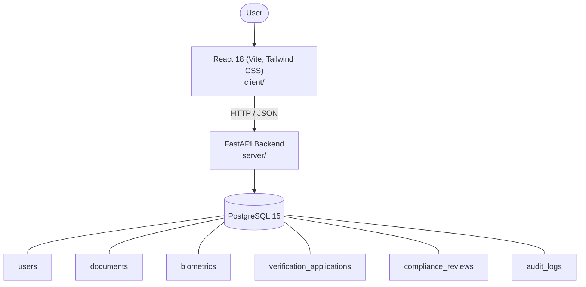

# Architecture

_Auto-generated by the SDLC Assistant from the generated codebase and the approved Feature Spec (latest: SCRUM-490). Regenerated on each push._

## System Diagram

## Tech Stack
- **language**: Python 3.11
- **backend_framework**: FastAPI
- **orm**: SQLAlchemy 2.x
- **database**: PostgreSQL 15
- **frontend**: React 18 (Vite, Tailwind CSS)
- **cloud_provider**: GCP (Cloud Run, Cloud SQL, GCS)
- **constitution_section_4_followed**: True

## Backend Modules (server/)
- server/__init__.py
- server/config.py
- server/database.py
- server/dependencies.py
- server/main.py
- server/models/__init__.py
- server/models/application.py
- server/models/audit.py
- server/models/biometric.py
- server/models/compliance.py
- server/models/document.py
- server/models/user.py
- server/routers/__init__.py
- server/routers/admin.py
- server/routers/auth.py
- server/routers/biometrics.py
- server/routers/compliance.py
- server/routers/documents.py
- server/schemas/__init__.py
- server/schemas/audit.py
- server/schemas/auth.py
- server/schemas/biometric.py
- server/schemas/compliance.py
- server/schemas/document.py
- server/services/__init__.py
- server/services/audit_service.py
- server/services/auth_service.py
- server/services/biometric_service.py
- server/services/compliance_service.py
- server/services/ocr_service.py
- server/tests/__init__.py
- server/tests/conftest.py
- server/tests/test_admin.py
- server/tests/test_auth.py
- server/tests/test_biometrics.py
- server/tests/test_compliance.py
- server/tests/test_documents.py

## Frontend Modules (client/)
- (no client/ files found yet)

## API Endpoints
- POST /api/v1/auth/register
- POST /api/v1/auth/login
- POST /api/v1/auth/refresh
- GET /api/v1/auth/me
- POST /api/v1/documents/upload
- GET /api/v1/documents/{id}
- POST /api/v1/biometrics/verify
- GET /api/v1/biometrics/status
- GET /api/v1/compliance/applications
- GET /api/v1/compliance/applications/{id}
- POST /api/v1/compliance/applications/{id}/decision
- GET /api/v1/admin/audit-logs
- GET /api/v1/admin/audit-logs/export

## Data Model
- users
- documents
- biometrics
- verification_applications
- compliance_reviews
- audit_logs
