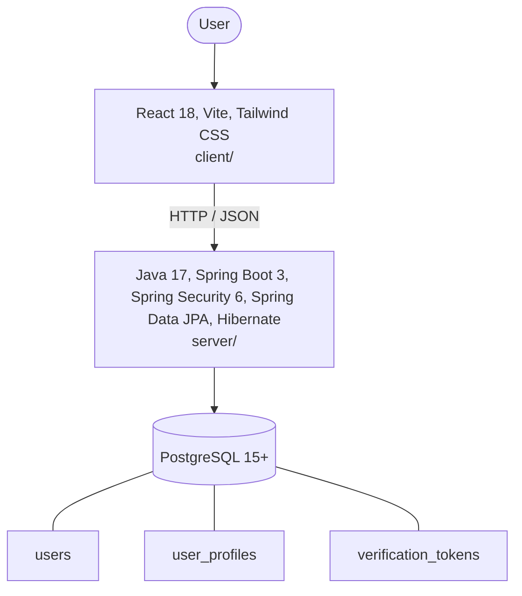

# Architecture

_Auto-generated by the SDLC Assistant from the generated codebase and the approved Feature Spec (latest: SCRUM-506). Regenerated on each push._

## System Diagram

## Tech Stack
- **backend**: Java 17, Spring Boot 3, Spring Security 6, Spring Data JPA, Hibernate
- **frontend**: React 18, Vite, Tailwind CSS
- **database**: PostgreSQL 15+
- **caching**: Redis 7.0
- **auth**: JWT (HMAC-SHA256 / RSA), BCrypt / Argon2id

## Backend Modules (server/)
- (no server/ files found yet)

## Frontend Modules (client/)
- (no client/ files found yet)

## API Endpoints
- POST /api/v1/auth/register
- POST /api/v1/auth/verify-email
- POST /api/v1/auth/login
- GET /api/v1/profile
- PUT /api/v1/profile

## Data Model
- users
- user_profiles
- verification_tokens
