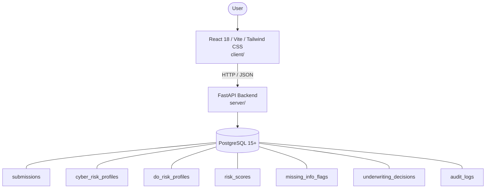

# Architecture

_Auto-generated by the SDLC Assistant from the generated codebase and the approved Feature Spec (latest: SCRUM-487). Regenerated on each push._

## System Diagram

## Tech Stack
- **language**: Python 3.11
- **backend_framework**: FastAPI
- **orm**: SQLAlchemy 2.x
- **database**: PostgreSQL 15+
- **frontend**: React 18 / Vite / Tailwind CSS
- **cloud_provider**: Google Cloud Platform (GCP)
- **constitution_section_4_followed**: True

## Backend Modules (server/)
- server/__init__.py
- server/database.py
- server/main.py
- server/models/__init__.py
- server/models/evaluation.py
- server/models/risk_profile.py
- server/models/submission.py
- server/routers/__init__.py
- server/routers/submissions.py
- server/routers/underwriting.py
- server/schemas/__init__.py
- server/schemas/decision.py
- server/schemas/submission.py
- server/services/__init__.py
- server/services/audit_service.py
- server/services/decision_service.py
- server/services/flagging_engine.py
- server/services/scoring_engine.py
- server/services/submission_service.py
- server/tests/__init__.py
- server/tests/conftest.py
- server/tests/test_submissions.py
- server/tests/test_underwriting.py

## Frontend Modules (client/)
- client/postcss.config.js
- client/src/App.jsx
- client/src/components/CarrierSubmissionWizard.jsx
- client/src/components/CarrierTrackingPortal.jsx
- client/src/components/CyberRiskDisclosures.jsx
- client/src/components/DecisionWorkbenchModal.jsx
- client/src/components/DoRiskDisclosures.jsx
- client/src/components/MissingInfoFlagsDrawer.jsx
- client/src/components/RiskScoreBadge.jsx
- client/src/components/UnderwriterQueueDashboard.jsx
- client/src/components/__tests__/CarrierSubmissionWizard.test.jsx
- client/src/components/__tests__/UnderwriterQueueDashboard.test.jsx
- client/src/main.jsx
- client/src/pages/CarrierSubmissionPage.jsx
- client/src/pages/CarrierTrackingPage.jsx
- client/src/pages/SubmissionDetailPage.jsx
- client/src/pages/UnderwriterQueuePage.jsx
- client/src/services/api.js
- client/src/setup.js
- client/tailwind.config.js
- client/vite.config.js

## API Endpoints
- POST /api/v1/submissions
- GET /api/v1/submissions
- GET /api/v1/submissions/{id}
- GET /api/v1/submissions/{id}/flags
- POST /api/v1/submissions/{id}/decisions
- GET /api/v1/underwriting/reasons

## Data Model
- submissions
- cyber_risk_profiles
- do_risk_profiles
- risk_scores
- missing_info_flags
- underwriting_decisions
- audit_logs
