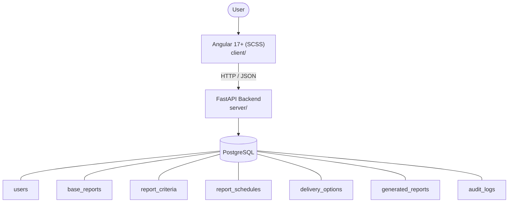

# Architecture

_Auto-generated by the SDLC Assistant from the generated codebase and the approved Feature Spec (latest: SCRUM-484). Regenerated on each push._

## System Diagram

## Tech Stack
- **language**: Java 17+
- **backend_framework**: Spring Boot 3.x
- **orm**: Spring Data JPA / Hibernate 6.x
- **database**: PostgreSQL
- **frontend**: Angular 17+ (SCSS)
- **cloud_provider**: Google Cloud Platform (GCP)
- **constitution_section_4_followed**: True

## Backend Modules (server/)
- (no server/ files found yet)

## Frontend Modules (client/)
- (no client/ files found yet)

## API Endpoints
- GET /api/reports
- POST /api/reports/generate
- GET /api/reports/{id}/export
- POST /api/reports/schedule
- POST /api/delivery-options
- POST /api/delivery-options/{id}/authorize
- POST /api/delivery-options/{id}/reject
- GET /api/lookup/branches
- GET /api/lookup/customers
- GET /api/lookup/accounts
- GET /api/lookup/report-names

## Data Model
- users
- base_reports
- report_criteria
- report_schedules
- delivery_options
- generated_reports
- audit_logs
