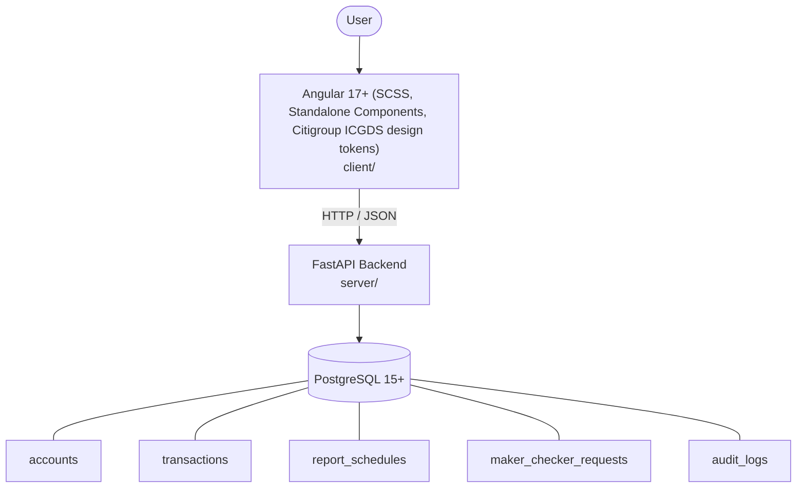

# Architecture

_Auto-generated by the SDLC Assistant from the generated codebase and the approved Feature Spec (latest: SCRUM-483). Regenerated on each push._

## System Diagram

## Tech Stack
- **language**: Java 17+
- **backend_framework**: Spring Boot 3.x
- **orm**: Spring Data JPA / Hibernate
- **database**: PostgreSQL 15+
- **frontend**: Angular 17+ (SCSS, Standalone Components, Citigroup ICGDS design tokens)
- **cloud_provider**: Google Cloud Platform (GCP) / Cloud Run
- **constitution_section_4_followed**: True

## Backend Modules (server/)
- (no server/ files found yet)

## Frontend Modules (client/)
- (no client/ files found yet)

## API Endpoints
- POST /api/v1/cash-statements/generate
- POST /api/v1/cash-statements/export
- GET /api/v1/cash-statements/export-jobs/{jobId}
- GET /api/v1/cash-statements/schedules
- POST /api/v1/cash-statements/schedules
- PUT /api/v1/cash-statements/schedules/{id}
- DELETE /api/v1/cash-statements/schedules/{id}
- GET /api/v1/cash-statements/authorizations/pending
- POST /api/v1/cash-statements/authorizations/{id}/approve
- POST /api/v1/cash-statements/authorizations/{id}/reject
- GET /api/v1/cash-statements/lookups/accounts
- GET /api/v1/cash-statements/lookups/report-templates
- GET /api/v1/cash-statements/audit-logs

## Data Model
- accounts
- transactions
- report_schedules
- maker_checker_requests
- audit_logs
